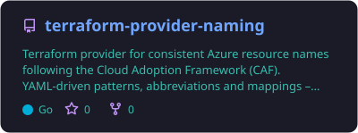
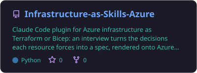
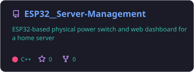
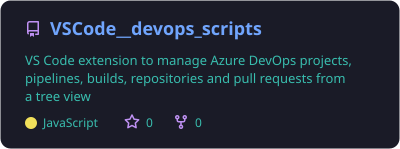

<div align="center">

# 👋 Hey, ich bin Daniel

[](https://github.com/LemurDaniel)

<sub>IT-Infrastruktur mit Terraform, Azure und PowerShell · denke in wiederverwendbaren, parametrischen Systemen statt Einzellösungen · baue gerade an AI-Skills für Infrastruktur</sub>

</div>

---

## 🧬 Quick Facts

```javascript
const Daniel = {
    pronouns: "He" | "Him",
    hobbys: ["Programming🧑‍💻", "AI Skills🤖", "3D Art🎨", "Space Stuff🧑‍🚀"],
    littleBitsOfMe: Buffer.from([0b01110010, 0b01101111, 0b01100010, 0b01101111, 0b01110100])
};
```

## 🛠️ Toolbox


## 🔭 Currently building

<div align="center">

<a href="https://github.com/LemurDaniel/Infrastructure-as-Skills-Azure"></a>

```
/plugin marketplace add LemurDaniel/Infrastructure-as-Skills-Azure
/plugin install infrastructure-as-skills-azure
```

<!-- PIN-CARDS:START -->
<a href="https://github.com/LemurDaniel/terraform-provider-naming"></a>
<a href="https://github.com/LemurDaniel/Infrastructure-as-Skills-Azure"></a>
<a href="https://github.com/LemurDaniel/ESP32__Server-Management"></a>
<a href="https://github.com/LemurDaniel/VSCode__devops_scripts"></a>
<!-- PIN-CARDS:END -->

[](https://registry.terraform.io/providers/LemurDaniel/naming/latest)
[](https://registry.terraform.io/modules/LemurDaniel/naming/random/latest)

<sub>🏷️ Naming-Provider (Go) &amp; Registry-Modul · 🧪 Infrastructure as Skills · 🔌 ESP32 Server-Switch · 🧩 Azure-DevOps VS-Code-Extension</sub>

</div>

---

<details>
  <summary>🎨 Creative Coding Sketches (p5.js)</summary>

  - 🎆 [Fireworks](https://editor.p5js.org/DanielL/full/3Q-JY7VGG)
  - 📐 [Sin/Cos Visualisation](https://editor.p5js.org/DanielL/full/Z4zcGhwxK)
  - 🎉 [Seek and Evade](https://editor.p5js.org/DanielL/full/EBHVYNqTJ)
  - 💥 [Recursive Explosions](https://editor.p5js.org/DanielL/full/enkxbZWm1)
  - 🚀 [Primitive Arrival with PID](https://editor.p5js.org/DanielL/full/3Q_k9lUO8)
  - 👾 [Vector Thrust](https://editor.p5js.org/DanielL/full/z8Mqzazzs)

</details>

---

<sub>🤖 **AI-Disclaimer:** Mittlerweile ist eine Menge Code in meinen Repos mit Claude Code entstanden. Die Ideen sind von mir, die Tippfehler inzwischen seltener. Wenn etwas komisch aussieht: Es war garantiert die AI. 😇</sub>
